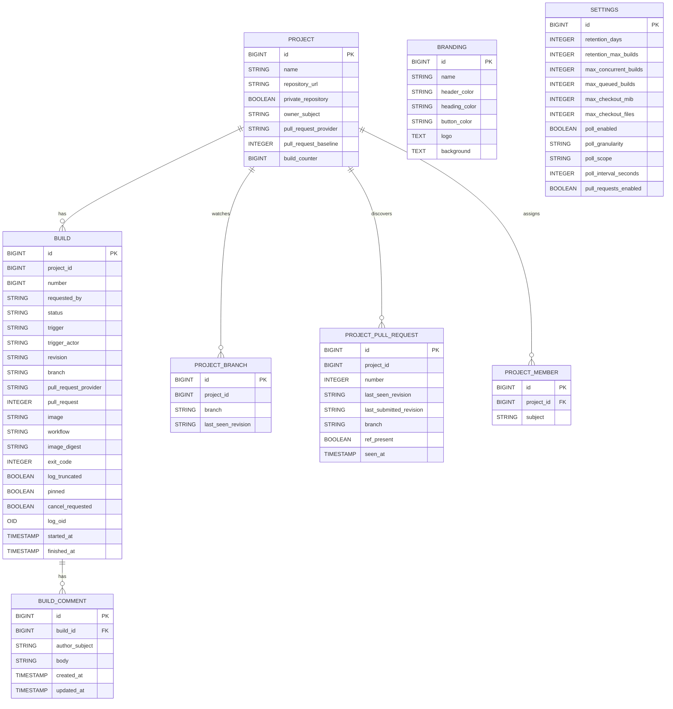

# Entity diagram

The entities are defined in `src/backend/main/java/ai/mnemosyne/cisys`. The schema is managed by Flyway migrations in `src/backend/main/resources/db/migration`, and Hibernate validates the entities against it (`quarkus.hibernate-orm.schema-management.strategy=validate`).

* `PROJECT.owner_subject` and `BUILD.requested_by` hold the Keycloak subject (`sub`) of the user. `PROJECT_MEMBER.subject` also holds a `sub`.
* `PROJECT_MEMBER.project_id` enforces one team row per subject per project via a unique `(project_id, subject)` index, and `PROJECT.owner_subject` is a leftover for init/compatibility; authorization uses `PROJECT_MEMBER`'s `role`, never the owner column.
* `BUILD.project_id` is a plain column, not a foreign key constraint.
* `BUILD_COMMENT.author_subject` holds the `sub` of the author, the only user who may edit the comment; `updated_at` is set on edit. Comments are deleted with their build.
* `BUILD.number` is unique within a project and taken from `PROJECT.build_counter`, which never goes back.
* `BUILD.logoid` (type `lo`, from the `lo` extension) references the build log, stored as one PostgreSQL large object. It is not mapped in the `Build` entity. The `lo_manage` trigger unlinks the large object when the build is deleted, so no logs are orphaned.
* `BUILD.status` is `QUEUED`, `RUNNING`, `PASSED`, `FAILED` or `CANCELLED`. `BUILD.cancel_requested` is set on a running build until the runner has stopped it.
* `BUILD.trigger` is `MANUAL`, `POLL` or `PULL_REQUEST`; a poll build stores the actor `poll` in `trigger_actor`, and a pull request build stores `pull-request`. A unique partial index keeps at most one build per `(project_id, revision)` for poll builds, whatever branch reached the commit and across restarts; manual builds may share a commit. A second partial unique index keeps at most one build per `(project_id, revision)` for pull request builds too, across pull request numbers. The application also skips a pull request build when any build of the project already has the commit, so a poll or manual build is reused and keeps its trigger. `BUILD.pull_request` and `BUILD.pull_request_provider` are set only for `PULL_REQUEST` builds and are never re-derived from a later repository URL.
* `PROJECT.pull_request_provider` (`GITHUB` or `GITLAB`) is stored when pull request builds are enabled. `PROJECT.pull_request_baseline` is the highest number present when the feature was seeded; a null baseline means the next discovery seeds without building the existing pull requests. A provider or repository URL change clears the cursors and resets the baseline.
* `PROJECT_PULL_REQUEST` is the discovery state of one pull request: the last head seen, the head already submitted or matched to an existing build, the same-repository branch that reaches the head, and whether the ref is still present. Storing the submitted head separately means deleting an old build through retention never rebuilds it. The unique key is `(project_id, number)`.
* `SETTINGS.pull_requests_enabled` (default false) is the global switch for pull request and merge request builds.
* `PROJECT_BRANCH` is the automatic-build cursor: the last commit cisys queued for each watched branch. A missing row makes the branch seed its tip on the next poll without building anything. The row is removed when the branch disappears, its tip loses the workflow file, or automatic builds are turned off.
* `SETTINGS.poll_enabled` (default true), `poll_granularity` (`PER_COMMIT` or `TIP`), `poll_scope` (`WORKFLOW` or `MAIN_ONLY`) and `poll_interval_seconds` (null uses `cisys.poll.every`) hold the global automatic-build settings.
* `BRANDING` and `SETTINGS` are singleton rows with `id = 1`. Until `SETTINGS` is first saved, its defaults apply.
* `PROJECT_MEMBER.subject` is the Keycloak subject of a user assigned to the project; a subject is assigned once per project, and the rows are deleted with the project.
* Users, roles and credentials live in Keycloak and are not stored in the cisys database. The Users page changes them through the Keycloak Admin REST API.
