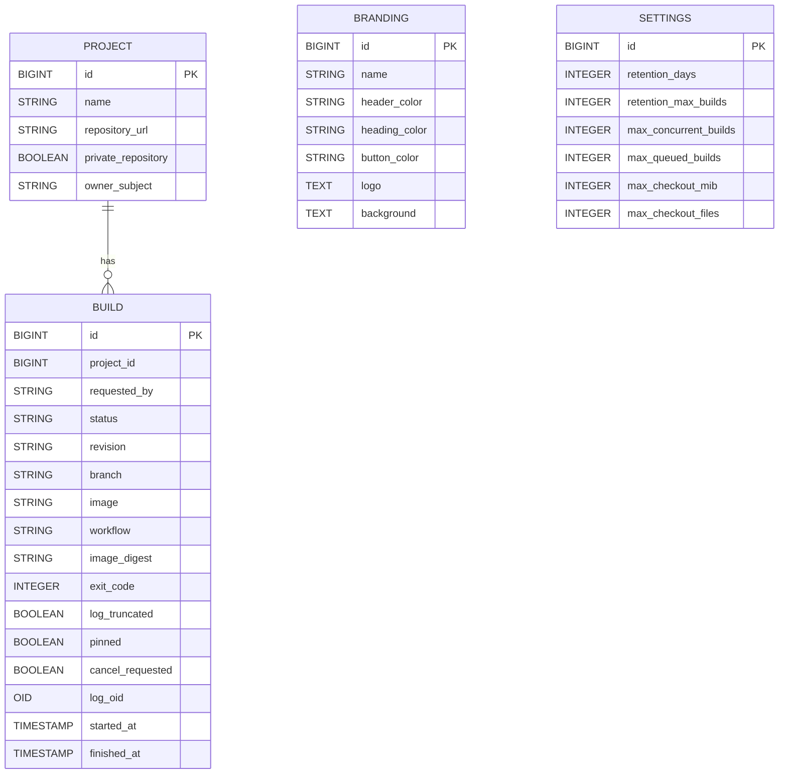

\newpage

# Architecture

## Backend

[**cisys**](https://github.com/mnemosyne-systems/cisys) is built on [Java](https://en.wikipedia.org/wiki/Java_(programming_language)) 25 and [Quarkus](https://quarkus.io/) 3.40 using [PostgreSQL](https://www.postgresql.org/) as the database.

The sources are in `src/backend/main/java/ai/mnemosyne/cisys`.

* The data model uses JPA entities backed by [Hibernate ORM Panache](https://quarkus.io/guides/hibernate-orm-panache): `Project`, `Build`, `Branding` and `Settings`.
* HTTP endpoints use JAX-RS via [Quarkus REST](https://quarkus.io/guides/rest): `ProjectResource` (`/api/session`, `/api/projects`), `BuildResource` (`/api/projects/{projectId}/builds`), `BrandingResource` (`/api/branding`) and `SettingsResource` (`/api/settings`).
* `BuildLogs` stores each build log as one PostgreSQL large object, using JDBC and the pgjdbc `LargeObjectManager` directly rather than Hibernate. Output is appended while the build runs and streamed back from `/api/projects/{projectId}/builds/{buildId}/log`, about 1 MB per short transaction, so a log is never held in memory whole. cisys supports PostgreSQL only.
* `BuildRunner` fetches repositories with [JGit](https://www.eclipse.org/jgit/) and runs builds through the Docker or Podman command line. It claims `QUEUED` builds in request order, up to the concurrency limit set under Settings or in configuration. Each dispatcher tick also stops the running builds whose cancellation was requested.
* `BuildRetention` is a [scheduled](https://quarkus.io/guides/scheduler) job that deletes each project's expired, unpinned builds in batches with one SQL statement per batch; the `lo_manage` trigger removes their logs.
* Authentication uses [Quarkus OIDC](https://quarkus.io/guides/security-oidc-bearer-token-authentication) in `service` mode with Keycloak realm roles.

Quarkus configuration is in `src/backend/main/resources/application.properties`. The schema is managed by [Flyway](https://quarkus.io/guides/flyway) migrations in `src/backend/main/resources/db/migration`, applied at startup; Hibernate only validates it. Databases created before migrations existed are adopted automatically. Until the 1.0 release the whole schema is one repeatable migration, `R__schema.sql`, which is changed in place and must stay idempotent; Flyway reruns it whenever it changes, so existing databases never need a manual reset.

## Frontend

The frontend is in `src/frontend`. It is a [React](https://react.dev/) application bundled with [Vite](https://vite.dev/) and styled with [Tailwind CSS](https://tailwindcss.com/) and [shadcn/ui](https://ui.shadcn.com/) components. The entry point is `src/main.jsx`.

Authentication uses [keycloak-js](https://www.keycloak.org/securing-apps/javascript-adapter) with PKCE, and the frontend calls the backend API at `http://localhost:8080/api`.

The `src/components` directory and `src/lib/utils.ts` were copied from [BilletSys](https://github.com/mnemosyne-systems/billetsys) under the Eclipse Public License 2.0. Most ticket-specific components are reference code and require their original supporting modules before use.

## Entity Model

Users and roles are managed in Keycloak; `owner_subject` and `requested_by` hold the Keycloak subject.
