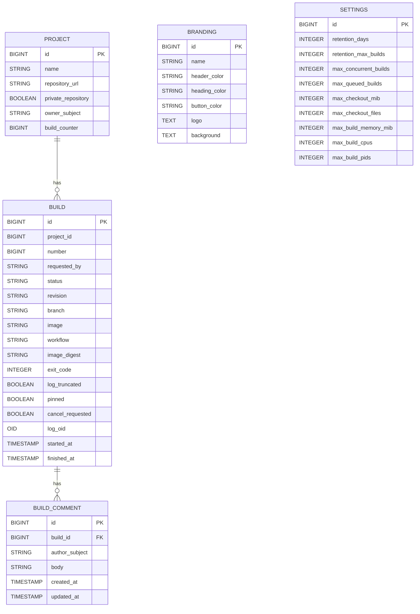

\newpage

# Architecture

## Backend

[**cisys**](https://github.com/mnemosyne-systems/cisys) is built on [Java](https://en.wikipedia.org/wiki/Java_(programming_language)) 25 and [Quarkus](https://quarkus.io/) 3.40 using [PostgreSQL](https://www.postgresql.org/) as the database.

The sources are in `src/backend/main/java/ai/mnemosyne/cisys`.

* The data model uses JPA entities backed by [Hibernate ORM Panache](https://quarkus.io/guides/hibernate-orm-panache): `Project`, `Build`, `BuildComment`, `Branding` and `Settings`.
* HTTP endpoints use JAX-RS via [Quarkus REST](https://quarkus.io/guides/rest): `ProjectResource` (`/api/session`, `/api/projects`), `BuildResource` (`/api/projects/{projectId}/builds`), `BuildCommentResource` (`/api/projects/{projectId}/builds/{buildId}/comments`), `BrandingResource` (`/api/branding`) and `SettingsResource` (`/api/settings`, including the global automatic-build settings under `/api/settings/polling`). A `@Scheduled` `CommitPoller` discovers new commits on a timer and queues them; there is no inbound push endpoint.
* `BuildLogs` stores each build log as one PostgreSQL large object, using JDBC and the pgjdbc `LargeObjectManager` directly rather than Hibernate. Output is appended while the build runs and streamed back from `/api/projects/{projectId}/builds/{buildId}/log`, about 1 MB per short transaction, so a log is never held in memory whole. cisys supports PostgreSQL only.
* `BuildRunner` fetches repositories with [JGit](https://www.eclipse.org/jgit/) and runs builds through the Docker or Podman command line. It claims `QUEUED` builds in request order, up to the concurrency limit set under Settings or in configuration. Each dispatcher tick also stops the running builds whose cancellation was requested.
* `EgressProxy` is a per-build HTTPS `CONNECT` proxy on a Unix socket. Podman mounts the socket directory into each step, which still runs with `--network=none`; `socat` in the step forwards `127.0.0.1:3128` to it. The proxy allows only the hosts set under Settings → Network (`NetworkHost` rows, checked as a `NetworkAllowlist`; `*` means every public host) on the configured ports, and never protected addresses. `NetworkTemplate` lists the hosts of well-known registries.
* `BuildRetention` is a [scheduled](https://quarkus.io/guides/scheduler) job that deletes each project's expired, unpinned builds in batches with one SQL statement per batch; the `lo_manage` trigger removes their logs.
* Authentication uses [Quarkus OIDC](https://quarkus.io/guides/security-oidc-bearer-token-authentication) in `service` mode with Keycloak realm roles.
* Health and metrics come from the [SmallRye Health](https://quarkus.io/guides/smallrye-health) and [Micrometer](https://quarkus.io/guides/telemetry-micrometer) extensions, exposed as `/health`, `/health/live`, `/health/ready` and `/metrics` on the management interface (port `9000`). They are plain HTTP routes, not Jakarta REST resources, so they are not covered by the authentication of the API. The management interface has no authentication by default. The readiness check includes the database connection and comes from the datasource extension.

Quarkus configuration is in `src/backend/main/resources/application.properties`. The schema is managed by [Flyway](https://quarkus.io/guides/flyway) migrations in `src/backend/main/resources/db/migration`, applied at startup; Hibernate only validates it. Databases created before migrations existed are adopted automatically. Until the 1.0 release the whole schema is one repeatable migration, `R__schema.sql`, which is changed in place and must stay idempotent; Flyway reruns it whenever it changes. The migration carries only schema DDL; team data is never repaired by it. Introducing the project team requires a database reset for databases created before this change: run `make reset`, which deletes the local PostgreSQL and Keycloak data volumes, including projects, builds and users. New projects automatically assign their creator the LEAD role at creation time; existing team data is not migrated or repaired. Databases created after the change are not affected, and not every future upgrade requires a reset.

## Frontend

The frontend is in `src/frontend`. It is a [React](https://react.dev/) application bundled with [Vite](https://vite.dev/) and styled with [Tailwind CSS](https://tailwindcss.com/) and [shadcn/ui](https://ui.shadcn.com/) components. The entry point is `src/main.jsx`.

Authentication uses [keycloak-js](https://www.keycloak.org/securing-apps/javascript-adapter) with PKCE, and the frontend calls the backend API at `http://localhost:8080/api`.

The `src/components` directory and `src/lib/utils.ts` were copied from [BilletSys](https://github.com/mnemosyne-systems/billetsys) under the Eclipse Public License 2.0. Most ticket-specific components are reference code and require their original supporting modules before use.

## Entity Model

Users and roles are stored in Keycloak and managed from the Users page through the Keycloak Admin REST API; `owner_subject`, `requested_by` and `projectmember.subject` hold the Keycloak subject. `projectmember.role` decides what a member can do in the project.
